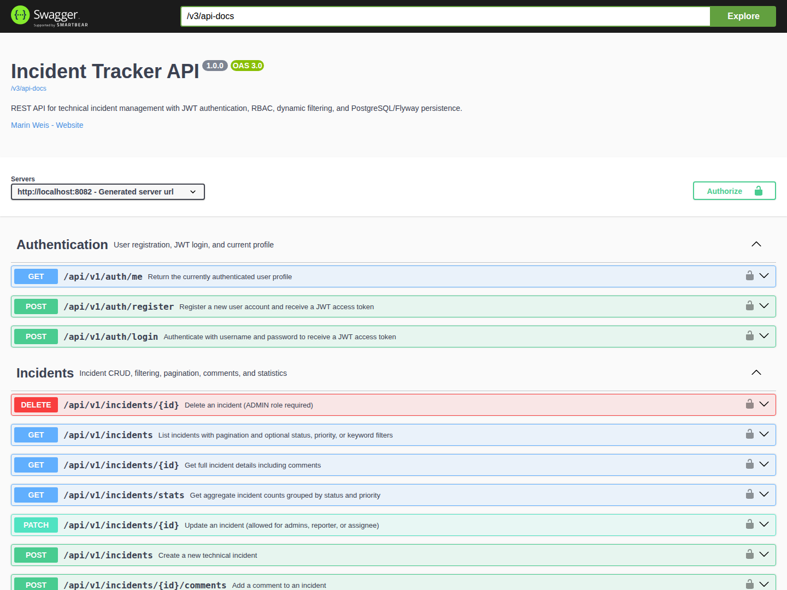
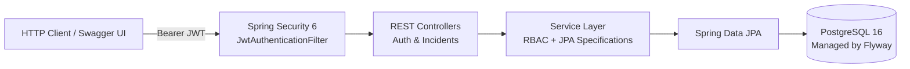

# Incident Tracker API — Java · Spring Boot 3 · PostgreSQL · JWT

[](https://github.com/Marin-Weis/incident-tracker-api/actions/workflows/ci.yml)

Production-style REST API for technical incident management built with **Java 17/21**, **Spring Boot 3**, **Spring Security (stateless JWT + RBAC)**, **PostgreSQL**, **Flyway** schema migrations, **RFC 7807 `ProblemDetail`** error responses, and interactive **OpenAPI 3 / Swagger UI** documentation.



## Architecture



### Key Technical Choices
- **Stateless JWT Authentication & RBAC**: BCrypt password hashing, HMAC-SHA256 JWTs (`jjwt`), method-level `@PreAuthorize("hasRole('ADMIN')")` on destructive actions, and ownership checks (reporter / assignee / admin) on updates.
- **Database Schema as Code**: Hibernate runs with `ddl-auto: validate` against versioned SQL migrations managed by **Flyway** (`V1__init_schema.sql`), ensuring schema drift is caught immediately.
- **Dynamic Filtering & Pagination**: `GET /api/v1/incidents` combines `status`, `priority`, and full-text keyword search (`q`) using type-safe Spring Data JPA `Specification` queries with clamped page sizes.
- **Standardized Error Handling**: `@RestControllerAdvice` returns RFC 7807 `ProblemDetail` payloads for validation errors (400 with field map), authentication (401), authorization (403), missing resources (404), and conflicts (409).
- **Automated Testing & CI**: Unit tests (`JwtServiceTest`) and full MockMvc integration tests (`IncidentApiIntegrationTest`) executed on both **Java 17** and **Java 21** via GitHub Actions, plus multi-stage non-root Docker build verification.

## API Endpoints

| Method | Path | Auth | Description |
|---|---|---|---|
| `POST` | `/api/v1/auth/register` | Public | Register a new `USER` account and return a JWT |
| `POST` | `/api/v1/auth/login` | Public | Authenticate and return a JWT |
| `GET` | `/api/v1/auth/me` | Bearer | Return current user profile |
| `GET` | `/api/v1/incidents` | Bearer | List incidents (`status`, `priority`, `q`, `page`, `size`) |
| `GET` | `/api/v1/incidents/stats` | Bearer | Aggregate counts grouped by status and priority |
| `GET` | `/api/v1/incidents/{id}` | Bearer | Get incident details and comment thread |
| `POST` | `/api/v1/incidents` | Bearer | Create a new incident |
| `PATCH` | `/api/v1/incidents/{id}` | Bearer | Update incident (reporter, assignee, or `ADMIN`) |
| `DELETE` | `/api/v1/incidents/{id}` | `ADMIN` | Delete an incident |
| `POST` | `/api/v1/incidents/{id}/comments` | Bearer | Add a comment to an incident |
| `GET` | `/actuator/health` | Public | Health check endpoint |
| `GET` | `/swagger-ui.html` | Public | Interactive OpenAPI 3 / Swagger UI |

## Quick Start

### Run with Docker Compose (PostgreSQL 16 + API)
```bash
docker-compose up --build -d
```
- **API**: http://localhost:8082
- **Swagger UI**: http://localhost:8082/swagger-ui.html
- **Health**: http://localhost:8082/actuator/health

### Run Tests Locally (Maven + H2 PostgreSQL mode)
```bash
mvn test
```

### Example Workflow (`curl`)
```bash
# 1. Register and capture JWT token
TOKEN=$(curl -s -X POST http://localhost:8082/api/v1/auth/register \
  -H "Content-Type: application/json" \
  -d '{"username":"alice","email":"alice@example.com","password":"Password123!"}' \
  | jq -r .accessToken)

# 2. Create an incident
curl -s -X POST http://localhost:8082/api/v1/incidents \
  -H "Authorization: Bearer $TOKEN" \
  -H "Content-Type: application/json" \
  -d '{"title":"Database pool saturation","description":"Connection pool hit 100% during peak traffic.","priority":"CRITICAL"}' | jq .

# 3. Filter incidents
curl -s "http://localhost:8082/api/v1/incidents?priority=CRITICAL&q=pool" \
  -H "Authorization: Bearer $TOKEN" | jq .
```

## Project Structure

```
.
├── src/main/java/dev/marinweis/incidents/
│   ├── config/          # SecurityConfig, OpenApiConfig
│   ├── controller/      # AuthController, IncidentController
│   ├── dto/             # Java record request/response DTOs
│   ├── exception/       # GlobalExceptionHandler (RFC 7807 ProblemDetail)
│   ├── model/           # JPA entities & enums
│   ├── repository/      # Spring Data JPA repositories
│   ├── security/        # JwtService, JwtAuthenticationFilter, AppUserDetailsService
│   └── service/         # AuthService, IncidentService, IncidentSpecifications
├── src/main/resources/
│   ├── application.yml
│   └── db/migration/    # Flyway SQL migrations (V1__init_schema.sql)
├── src/test/            # JUnit 5 unit & MockMvc integration tests
├── Dockerfile           # Multi-stage non-root image
├── docker-compose.yml   # PostgreSQL 16 + API stack
└── .github/workflows/ci.yml
```

## License
MIT
